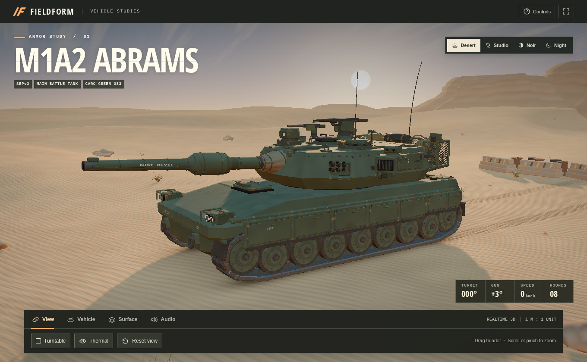

# M1A2 Abrams SEPv3

A browser-based 3D exterior study of an Abrams in CARC Green 383. Everything on the vehicle and in the environment is generated in the browser; there are no downloaded models, textures, or sound files.

[Open the interactive turntable](https://isiliconx.github.io/m1a2abrams/) · [Download the standalone HTML](https://raw.githubusercontent.com/isiliconx/m1a2abrams/main/index.html)

## Controls

| Control | What it does |
| --- | --- |
| Drag / scroll / pinch | Orbit and zoom |
| Right-drag | Pan |
| Left / right arrows | Turn the turret |
| Up / down arrows | Tilt the gun |
| Hold W / S | Drive forward / reverse |
| Space | Play the cosmetic shot effect |
| R | Restore the opening camera view |

Use the **View** tab for the turntable and white-hot filter, **Vehicle** for motion and hatches, **Surface** for paint, dust, wear and removable exterior props, and **Audio** for the four synthesized sound channels. Sound starts muted. **Desert**, **Studio**, **Noir**, and **Night** each use their own lights and reflections.

## Run offline

Open `index.html` in a modern browser with WebGL and hardware acceleration enabled. The HTML includes its styles, scripts, and Three.js r160 modules. It requires no build step, server, or network. The renderer reduces pixel density and falls back to simpler shading on lower-power hardware.

A visual model with simplified motion and effects. It does not simulate ballistics, targeting, or the operation of real vehicle systems.
